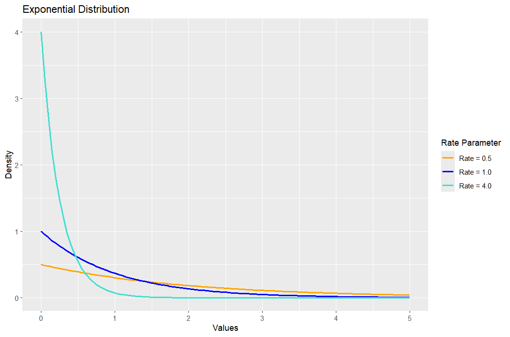
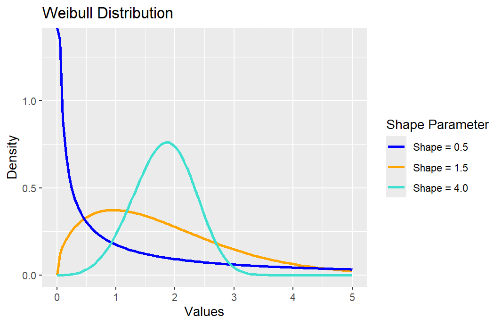
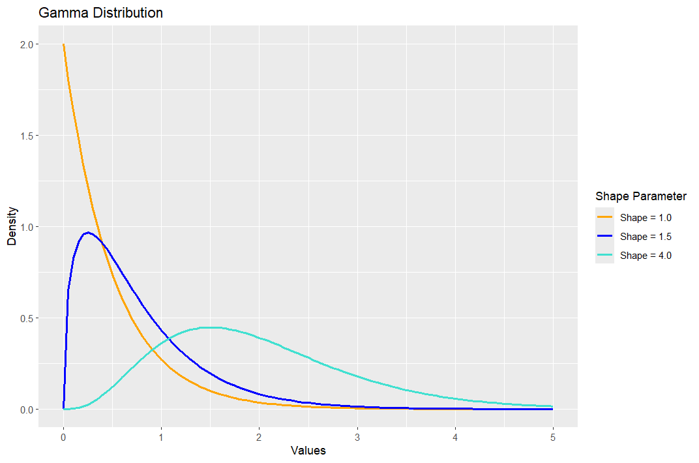
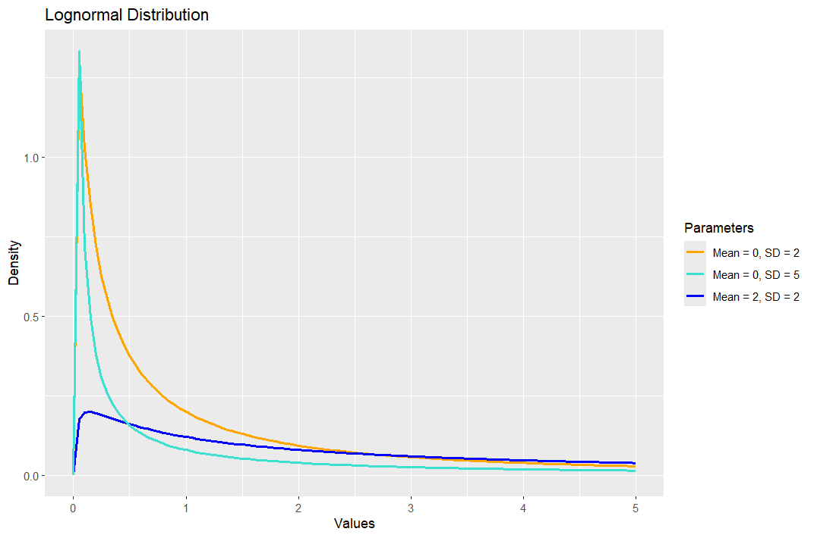
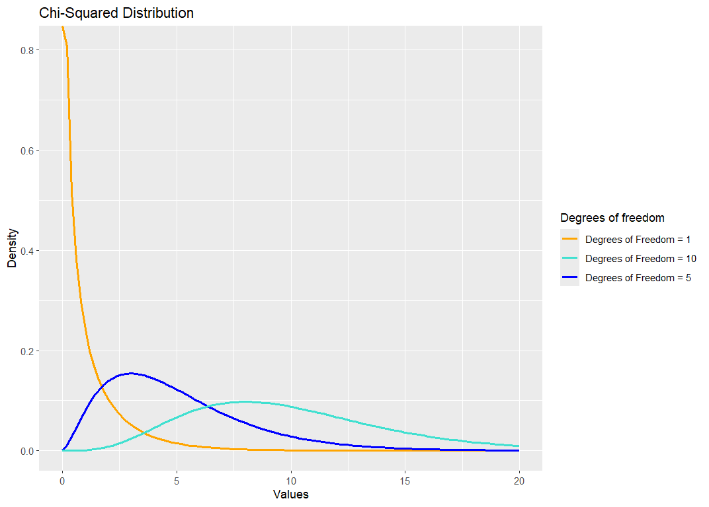
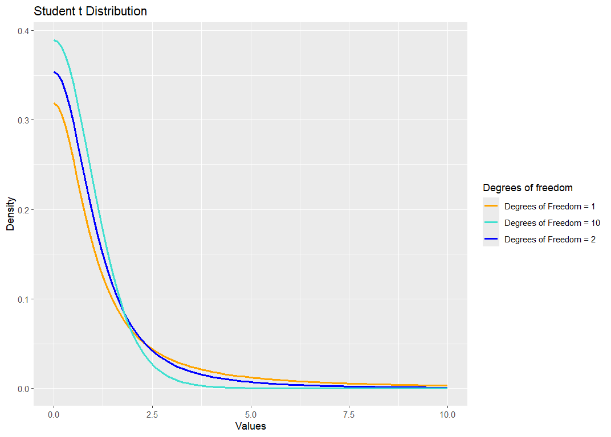
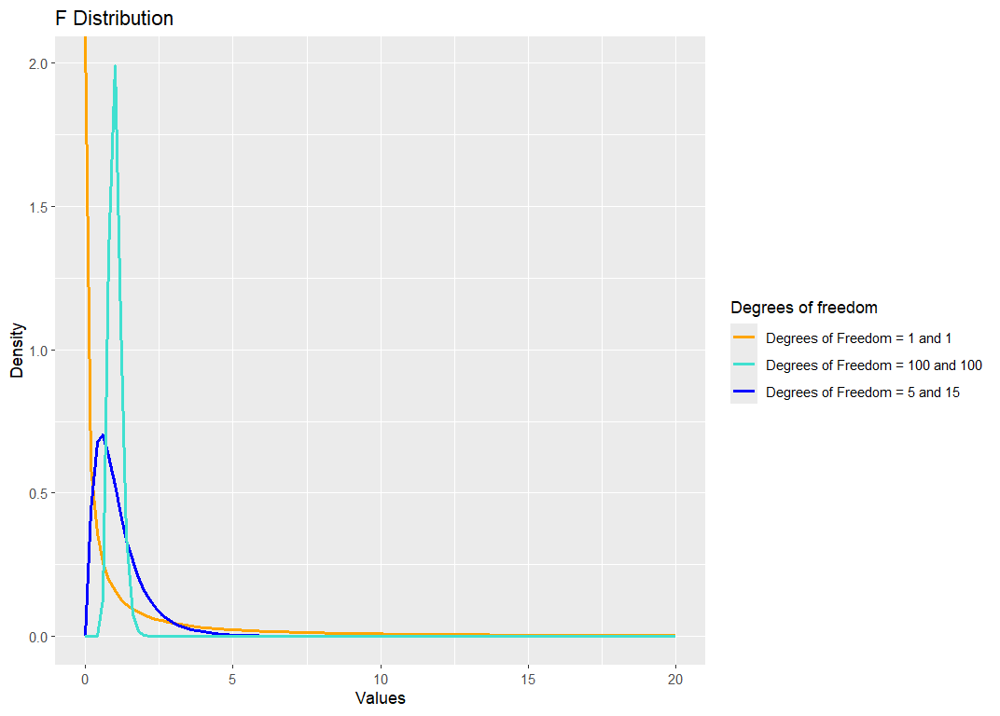

---
title: "Continuous distributions"
format:
  html:
    toc: true
    number-sections: false
execute:
  eval: false
  echo: false
  warning: false
  error: false
---

A random variable $X$ that can take any value within a given range is said to be a *continuous random variable*. Unlike discrete random variables, continuous random variables are uncountable.

A  continuous random variable $X$ is described by its *probability density function*
(pdf), $f, f \geq$ 0 and $\int^{\infty}_{-\infty}f(x)\ dx$ = 1. Where $f(x)$ is a pdf,
$$
P(a \leq X \leq b) = \int^b_af(x)\ dx, \qquad\text{for} \ a < b.
$$
Note that for $a = b, P(X = a) = \int^a_af(x)\ dx$ = 0. This means that the probability that
a continuous random variable assumes a certain value is zero. From here it also follows that
$$
P(a \leq X \leq b) = P(a < X < b),
$$
i.e. the probability that $X$ lies in an interval does not depend on the end points of the interval.

The cumulative distribution function (cdf) is defined as
$$
F(x) = P(X \leq x) = \int^x_{-\infty} f(t)\ dt.
$$
$F$ is an increasing function: for $x_1 \leq x_2$, $F(x_1) \leq F(x_2)$, with F($-\infty$) = 0, F($\infty$) = 1.
Further, we have
\begin{gather*}
  F'(x) = f(x), \\
  \mu = E[X] = \int^{\infty}_{-\infty} x f(x)\ dx,\\
  E[g(X)] = \int^{\infty}_{-\infty} g(x) f(x)\ dx,\\
  VarX=E(X-E[X])^2=\int^{\infty}_{-\infty} (x-\mu)^2 f(x)\ dx.
\end{gather*}

As we saw earlier in the course, the $100p^{\mbox{th}}$ percentile is a number, $x_p$, such that the area under $f(x)$ to the left of $x_p$ is $p$. That is
$$
 p = \int_{-\infty}^{x_p} f(x) dx = F(x_p).	
$$
This method can also be used to find the median and inter-quartile range for a given distribution. 

We will discuss the following continuous distributions:

1. Uniform distribution
2. Exponential distribution
3. Normal or Gaussian distribution
4. Log-normal distribution
5. Gamma distribution
6. Weibull distribution
7. Beta distribution
8. $\chi^2$ distribution
9. t-distribution
10. F-distribution

## Uniform distribution ##

A continuous random variable $X$ is uniformly distributed if its density function is given by
$$
f(x) = \left\{
\begin{array}{ll}
\frac{1}{b-a} \qquad & a \leq x \leq b \\
0 \qquad & \mbox{otherwise}
\end{array}
\right.
$$
The mean and variance of the uniform distribution are
$$
\mu = \frac{a+b}{2},\qquad \mbox{and}\qquad \sigma^2=\frac{(b-a)^2}{12}.
$$
We write $X \sim$ U(a,b).

> **Exercise** Show that the cumulative distribution function $F$ is given by
> $$
>     F(x) = \left\{
>     \begin{array}{ll}
>     0, \qquad & x < a,\\
>     \frac{x-a}{b-a}, \qquad & a \leq x \leq b,\\
>     1,\qquad & x > b.
>     \end{array}
>     \right.
> $$


## Exponential distribution ##

We have seen that the Poisson distribution is used to examine the number of occurrences
of an event over specific time or space interval.The exponential distribution gives a
description of the length of the time interval between each occurrence.

### (a) Deriving the exponential distribution from the Poisson ###

Suppose the discrete random variable $X$ follows the Poisson distribution with $\lambda$ being
the mean number of independent arrivals per time unit.
Let $T$ be the number of time units until the first event happens. We would like to derive the 
probability of $T$.

Suppose $T$ takes the value $t$, then the mean number of events happening over the time $(0, t)$ 
is $\lambda t$. Let $Y_t$ be the random variable following $\texttt{Poisson}(\lambda t)$.
Then the probability that $T > t$ equals the probability that $Y_t = 0$:
$$
  P(T > t) = P(Y_t = 0) = e^{-\lambda t}.
$$
The cumulative distribution of $T$ is
$$
  F(t) = 1 - P(T > t) = 1 - e^{-\lambda t}.
$$
The density function is
$$
  f(t) = F'(t) = \lambda e^{-\lambda t}.
$$


> ## Definition: Exponential Distribution ##
> A continuous random variable $T$ has an *exponential* distribution if its
> density function is given by
> $$
> f(t) = \lambda e^{-\lambda t},\qquad t \geq 0,\qquad \lambda >0.
> $$
> We write $T \sim$ \texttt{exp}($\lambda$). 

By solving a few integrations, we have the following relationships.

1. $P(a\leq T\leq b)=\int^b_a\lambda e^{-\lambda t}\ dt=e^{-\lambda a}- e^{-\lambda b}$;
2. $F(t) = P(T \leq t) = \int^t_0 \lambda e^{-\lambda x}\ dx = 1-e^{-\lambda t}$;
3. $f(t) = F'(t) = \lambda e^{-\lambda t}$;
4. The median $M$ is a value for which $F(M) = 1/2$, so $M = (\ln 2)/\lambda$;
5. The mean $\mu = \int^{\infty}_0 tf(t)\ dt = \int^{\infty}_0 t \lambda e^{-\lambda t}\ dt = 1/\lambda$;
6. The variance $\sigma^2 = \int^{\infty}_0 (t-\mu)^2f(t)\ dt = 1/\lambda^2$;

### (b)  Memoryless property ###

For $x, y \geq 0$,
$$
P(T>x+y|T>x) = \frac{P(T>x+y)}{P(T>x)} = \frac{e^{-\lambda(x+y)}}{e^{-\lambda x}} = e^{-\lambda y} = P(T>y)
$$
This shows that the exponential distribution has the memoryless property.




> ## Examples: ## 
> If we consider events occurring at a constant rate $\lambda$
(i.e., the mean number of independent arrivals per time unit is $\lambda$) and $T$ is the
time until the first event occurs, then T $\sim$ $\texttt{exp}(\lambda)$.

We may think of $T$ as

  * Times between calls at a telephone exchange,
  * Times between two customers at a post office,
  * Times between emissions of unstable radioactive elements,
  * Time between two accidents at an intersection,
  * Lifetime of some type of instrument, etc.

> ## Example: Disruptions ##
> 	An industrial plant in England has a mean number of disruptions per week equal to $\lambda = 0.4$. The number of accidents follows a Poisson distribution.
> 	What is the probability that the time between accidents is less than $2$ weeks?

> ## Solution ## 
> Since the number of accidents follows $\texttt{Poisson}(\lambda)$, then the time
> $T$ between two consecutive accidents follows the exponential distribution $\texttt{exp}(\lambda)$.
> Then
> $$
>  F(T \le 2) = F(2) = 1- e^{-2\lambda} = 1 - e^{-0.8} = 0.5507.
> $$
> Thus, the probability of less than $2$ weeks between accidents is about $55\%$.


## Weibull distributions ##

For the exponential distribution, the mean number of arrivals per
time unit is *constant*. However, in many real applications, it varies over time. 
The *Weibull distribution* allows the mean number of arrivals to be time dependent, $\lambda(t)$. It is often used to describe the time to failure, where an arrival corresponds to a failure.

Let $T$ be the time until an event occurs, such as the failure of some mechanical component. We can think of $T$ as the \textbf{lifetime} of that component.
The *survival function* is defined by
$$
   S(t) = P(T > t) = 1 - F(t),
$$
where $S(t)$ is the probability that the component survives beyond the time $t$.

The (age dependent) rate of failure, also called the *hazard function* $\lambda(t)$ of the random variable $T$, is defined as
$$
\lambda(t) = \lim_{dt \rightarrow 0}\frac{P(T \leq t + dt| T > t)}{dt},
$$
where $dt$ is a small interval of time. This can also be thought of as the instantaneous failure rate at $t$, per unit of time, given that the system has already
survived until time $t$. 

The conditional probability in the numerator can be written as the ratio of the joint
probability that $T$ is in the interval $[t, t+dt)$ and $T > t$ to the probability that $T > t$:
$$
 P(T \leq t + dt| T > t) = \frac{P(T \le t +dt, \ T>t) }{P(T > t)}
  	                     = \frac{P(t \le T \le t +dt) }{P(T > t)}
  	                     = \frac{f(t)dt}{S(t)},
$$
where the last equality applies when $dt$ is small enough. Therefore,
$$
  \lambda(t) = \lim_{dt \rightarrow 0}\frac{\frac{f(t)dt}{S(t)}}{dt} 
             = \frac{f(t)}{S(t)}.
$$
By the definition of the survival function, we have
$$
S'(t) = -F'(t) = - f(t).
$$
Hence,
$$
\lambda(t) = \frac{-S'(t)}{S(t)}.
$$
This is a differential equation with the boundary condition $S(0) = 1$. 
Hence
$$
S(t) = \exp\left\{ - \int_0^t \lambda(x) dx  \right\}
$$
and
$$
f(t) = \lambda(t) S(t) = \lambda(t) \exp\left\{ - \int_0^t \lambda(x) dx  \right\}.
$$

*Special case:* If the rate of failure is constant, $\lambda(t) = \lambda$, then
$$
f(t) = \lambda e^{-\lambda t}\ \ \mbox{for} \ \ t \geq 0,
$$
and $T \sim$ exp($\lambda$). Assuming that $\lambda(x)$ is constant means that ageing has no effect and the component fails at random. 

The Weibull class of distributions arise from lifetime or reliability models and are applied to reliability theory when ageing is taken into account.

> ## Definition: Weibull Distribution ##
> A random variable $T$ has a Weibull distribution with parameters $\lambda$
> and $k$ if its hazard function is of the form
> $$
> \lambda(t) = k\lambda t^{k-1}, \ \ t >0 \ \ \mbox{for}\ \ \ k,\ \lambda>0
> $$
> and in this case, $T \sim$ Weibull($\lambda, k$).


We have
\begin{align*}
  S(t) & = e^{-\int^t_0\lambda(x)\ dx} = e^{-\lambda t^k}, \\
  f(t) & = \lambda(t)e^{-\int^t_0\lambda(x)\ dx}\\
       & = k\lambda t^{k-1} e^{-\lambda t^k}  \text{ for } x \geq 0 
            \text{and}  \lambda, k > 0.\\
\end{align*}
The mean and the variance of the Weibull distributions are
$$
\mu = \lambda^{-1/k}\Gamma(1+1/k); \ \sigma^2 = \lambda^{-2/k}(\Gamma(1+2/k)-\Gamma(1+1/k)^2),
$$
where $\Gamma$ is the gamma function:
\begin{align*}
    \Gamma(p) & = \int^{\infty}_0 x^{p-1}e^{-x}\ dx \ \mbox{for}\ p>0; \\
    \Gamma(p) & = (p-1)\Gamma(p-1)\ \mbox{for all} \ p>1; \Gamma(1) = 1; \Gamma(1/2)=\sqrt{\pi}; \\
    \Gamma(n) & = (n-1)!
\end{align*}
For other values of $n$, the values of $\Gamma$-function are given in tables. The graphs of the
Weibull pdf for different parameters $\lambda$ (scaling) and $k$ (shape value) are shown in the figure.
The Weibull distribution has a similar shape and flexibility as the Gamma pdf.




## Gamma distribution ##

Let $X$ be the waiting time for $k$ random events to occur where the events are occurring at constant rate $\lambda$.
That is, $X$ is the sum of $k$ independent exponentially distributed random variables with parameter
$\lambda$, $X = \sum^k_{i=1}X_i, X_i\sim exp(\lambda)$, i.i.d. Then the random variable $X$ follows a
*Gamma* distribution.

> ## Definition: Gamma Distribution ## 
> A continuous random variable $X$ has a Gamma distribution if its density
function is given by
> $$
> f(x) = \frac{\lambda^kx^{k-1}e^{-\lambda x}}{\Gamma(k)} \ \mbox{for} \ x\geq0.
> $$
> We write $X \sim \Gamma(\lambda,k)$ ($k$: shaping parameter; $\lambda$: scaling parameter).

The graph of the Gamma pdf is shown in the figure.



Where $k$ is integer, the gamma distribution is also known as the Erlang distribution. 

The mean and variance of the gamma distribution are given by
$$
    E[X] = \frac{k}{\lambda}, \ \mbox{and} \ Var(X) = \frac{k}{\lambda ^2}.
$$
The easiest way to see this is to represent $X$ as the sum of $X_i$ i.i.d. random variables,$X_i \sim$ exp$(\lambda), i = 1,2,...,k$.

> ## Example: Call Centre ##
> Telephone calls arrive at an office at a mean rate of $\lambda = 2$ per minute according to a Poisson process.
> Let $X$ denote the waiting time in minutes until the fifth call arrives. 
> The pdf of $X$ with $k=5$ and $\lambda = 2$ is
> $$
>   f(x) = \frac{2^5x^4}{4!} e^{-2x},
> $$
> and the mean is $\mu = k/\lambda = 5/2$, the variance is $\sigma^2 = k/\lambda^2 = 5/4$.


## Normal Distribution $N(\mu,\sigma^2)$ ##
The importance of the normal distribution comes from the *Central Limit Theorem*, (CLT)}, a very important
theorem that will be covered later. Normal distributions are generally used to model measurement errors, as well
as many natural phenomena.

> ## Definition: Normal Distribution ## 
> A continuous random variable $X$ is normally distributed if its probability
density function $f$ is given by
> $$
> f(x) = \frac{1}{\sqrt{2\pi\sigma^2}}e^{-(x-\mu)^2/2\sigma^2} \qquad \mbox{for} \ -\infty < x < \infty.
> $$
> We write $X \sim N(\mu, \sigma^2)$, where $\mu = EX$ and $\sigma^2 = Var(X)$.

In the special case when $\mu = 0$
and $\sigma^2 = 1$, the distribution is called the *standard normal* distribution. A random
variable with the standard normal distribution is called a *standard normal* random
variable and it is often denoted by $Z$. If $Z \sim N(0, 1)$ then
$$
\sigma Z+\mu \sim N(\mu, \sigma^2).
$$
On the other hand, if $X \sim N(\mu, \sigma^2)$ then
$$
Z = \frac{X-\mu}{\sigma} \sim N(0,1).
$$
The distribution function of the standard normal variable is denoted by $\Phi$ and its values
are given in statistical tables. The cumulative distribution function for a general normal distribution, $F$, can be obtained from $\Phi$ via the transformation
$$
F(x) = \Phi((x - \mu)/\sigma).
$$
The values of $\Phi^{-1}$ give *percentage points* of
the standard normal distribution and are given in statistical tables. 

For example, if
$Z \sim N(0, 1)$,
then $P(Z > 1.6449) = 5\%$ and $P(Z > 1.9600) = 2.5\%$.

That is, $\Phi^{-1}$(0.95) = 1.6449 and $\Phi^{-1}$(0.975) = 1.9600.

In statistical applications, we are often interested in finding a number $z_{\alpha}$
such that
$$
  P(Z \ge z_{\alpha}) = \alpha,
$$
with $Z \sim N(0,1)$ and $\alpha$ is usually less than $0.5$.
That is, $z_{\alpha}$ is the $100(1-\alpha)^{\mbox{th}}$ percentile 
for the standard normal distribution. 

*Remark:* (z-score) The $X$ is a random variable with $E[X]=\mu$ and
$E[(X-\mu)^2] = \sigma^2$. Then the $Z$-score is defined by
$$
Z = \frac{X - \mu}{\sigma}.
$$
The $E[Z] = 0$ and $Var(Z) = Var(X)/\sigma^2 = 1$. But it does not necessarily follow
the standard normal distribution.

### Normal approximation of binomial distributions ###
We have seen that the number of successes in a sequence of $n$ identical, independent
trials with the constant probability of success in each trial $p$, is given by
$$
\begin{pmatrix} n \\ k \end{pmatrix}p^k(1-p)^{n-k}.
$$
These probabilities are tabled but usually not for values $n > 20$. However if $np \geq 5$
and $nq \geq 5$; the binomial distribution can be approximated by the normal distribution.
(CLT).


## Lognormal distribution ##
If $Y \sim N(\mu, \sigma^2)$ then $X = e^Y$ is said to have a lognormal distribution. The density of
$X$ is
$$
f(x) = \frac{1}{\sqrt{2\pi\sigma^2}x}exp\{-(\log (x)-\mu)^2/2\sigma^2\} \ \mbox{for} \ 0<x<\infty.
$$
The graph of the lognormal distribution is shown in the figure. 



One of the main reasons why the normal
distribution is more popular than the lognormal lay in the fact that the normal distribution is a symmetric
distribution. The hazard function $\lambda$(x) of a lognormal increases initially then declines; the lognormal
can be useful as a length of service distribution. Noting that $\mu$ and $\sigma^2$ are the mean and variance
of $Y$, not $X$, we have the following statistics for $X$

1. The mode is $e^{\mu-\sigma^2}$;
2. The median $M = e^{\mu}$;
3. The mean $E(X) = e^{\mu+ \frac{\sigma^2}{2}}$;
4. The variance $Var(X)= e^{2\mu+\sigma^2}(e^{\sigma^2}-1)$.


## Sampling distributions ##

The $\chi^2$, $t$ and $F$ distributions are known as *sampling distributions*. They are derived from
the normal distribution, and are used when performing hypothesis tests or calculating confidence intervals.
For each of these distributions, we will be using the statistical tables of percentage points. The point
$x_\alpha$ such that
$$
P(X > x_\alpha) = \alpha
$$
is known as 100(1 - $\alpha$)\% percentage point of a random variable $X$.


### $\chi^2$ distribution ###

Suppose $Z_1,...,Z_v$ are i.i.d. $N(0, 1)$, then $X = Z_1^2 + \cdots + Z_v^2$ is said to have a $\chi^2_v$
distribution. It can be shown that its probability density function is given with
$$
f(x) = \frac{1}{x^{v/2}\Gamma(\frac{v}{2})} x^{\frac{v}{2}-1}e^{-\frac{x}{2}} \ \mbox{for} \ x \geq0,
$$
where $\Gamma(\frac{v}{2})$ denotes the Gamma function.

We say that X has a chi-squared distribution with $v$ degrees of freedom, and we write $X \sim \chi^2_v$.
It can be shown that a $\chi^2_v$ is the same distribution as a $\Gamma(1/2,v/2)$.
Thus, $\chi^2$ is a special case of the Gamma distribution.

> ## Example: Exponential and $\chi^{2}$-Distributions## 
> If $X$ has an exponential with a mean of $2$ ($\lambda = 1/\mu = 1/2$),
> then the pdf of $X$ is
> $$
> f(x) = \frac 12 e^{-x/2} = \frac{x^{2/2 - 1} e^{-x/2}  }{ \Gamma(2/2) 2^{2/2}  } 
> \ \sim \ \chi_2^2.
> $$

The mean of $\chi_v^2$ equals the number of degree of freedom, and the variance equals twice the
number of degree of freedom:
$E[X] = v$ and $Var(X) = 2v$. A common application of the $\chi^2$ distribution is in the
comparison of expected and observed frequencies, known as *goodness of fit*. The
graph of the $\chi^2$ probability distribution function is shown in the figure.



The $100(1-\alpha)^{\mbox{th}}$ percentile (or upper $100 \alpha^{\mbox{th}}$ percent point) $\chi^2_{v, \alpha}$ is
$$
  P(X \ge \chi^2_{v, \alpha} ) = \alpha.
$$


### Student's $t$ distribution ###

Let $X$ and $Y$ are independent random variables and $X \sim N(0, 1)$, $Y \sim \chi^2_v$. Then the random
variable
$$
T = \frac{X}{\sqrt{Y/v}}
$$
has a $t$ distribution with $v$ degrees of freedom.
We write $T \sim t_v$.

The density of $T$ is given as
$$
f(x) = \frac{\Gamma((v+1)/2)}{\sqrt{v\pi}\Gamma(v/2)}\left(1+\frac{x^2}{v}\right)^{-(v+1)/2} \ \mbox{for} \ -\infty < x < \infty
\]
The $t_v$ distribution is symmetric and in its shape it is similar to the $N(0, 1)$, but with longer tails.
As $v\rightarrow \infty$, $t_v\rightarrow N(0, 1)$. The graph of the $t$-probability density function
is shown in the figure.




### F distribution ###

The $F$ distribution is used to compare variances.

If $X$ and $Y$ are independent random variables with $X\sim\chi^2_{\alpha}$ and $Y\sim \chi^2_{\beta}$, then
$$
T = \frac{X/\alpha}{Y/\beta}
$$
is said to have an $F_{\alpha, \beta}$ distribution.

We write $T \sim F_{\alpha, \beta}$. The density function of T is given as
$$
f(x) = \frac{\Gamma((\alpha+\beta)/2)}{\Gamma(\alpha/2)\Gamma(\beta/2)}\left(\frac{\alpha}{\beta}\right)^
        {\alpha/2}x^{(\alpha/2)-1}\left(1+\frac{\alpha}{\beta}x\right)^{-(\alpha+\beta)/2}, \ \mbox{for} \ x>0.
$$
The graph of the $F$ pdf is shown in the figure.




## Distribution of mixed type ##

So far, we have considered random variables that are either discrete or continuous.
However, on some occasions, combinations of the two types of random variables are also
encountered. That is, in some experiments, positive probability is assigned to each of
certain points and also spread over an interval of outcomes.

> ## Example: Mixed Distribution ##
> A fair coin is tossed. If it is Head, the player receives $\£ 2$.
> If it is Tail, the player spins a balanced spinner that has a scale from $0$ to $1$.
> Then the player receives that fraction of a pound associated with the point selected
> by the spinner.
> If $X$ denotes the amount received, what is the probability function of $X$.

> ## Solution ##
> There is $1/2$ chance for $x=2$; and the other $1/2$ chance that the player is going to spin the spinner, which is uniformally distributed over $[0, 1]$. 
> Hence the pdf is
> $$
> p(x) = \left\{
> \begin{array}{ll}
> 0   & \ \mbox{when} \ x < 0 \\
> 1/2 & \ \mbox{when} \ 0\le x \le 1 \\
> 0   & \ \mbox{when} \ 1 < x < 2 \\
> 1/2 & \ \mbox{when} \ x= 2 \\
> 0   & \ \mbox{when} \ x > 2
> \end{array} 
> \right .
> $$
> Its cdf is
> $$
> F(x) = \left\{
> \begin{array}{ll}
> 0 & \mbox{for} \ x < 0 \\
> \frac{x}2 & \mbox{for} \  0 \le x \le 1 \\
> \frac 12  & \mbox{for} \  1 < x < 2 \\
> 1         & \mbox{for} \ x \ge 2. \\
> \end{array} 
> \right . 
> $$
> The mean is
> $$
> \mu = E[X] = \int_0^1 x/2 dx + 2 \times \frac 12 = \frac 14 + 1 = \frac 54.
> $$
> The variance is
> $$
> \sigma^2 = E[X^2] - \mu^2 = \int_0^1 x^2/2 dx + 2^2 \frac 12 - (5/4)^2
> = \frac{29}{48}.
> $$

## R Code for Producing Plots
The R code for producing each of the plots follows a similar pattern. Below we include the code for generating the Weibull curves.

```{r, echo=TRUE, eval=FALSE}
ggplot() +
  xlim(0, 5) +
stat_function(fun = dweibull, args = list(shape = 1.5, scale = 2), 
              aes(color = "Shape = 1.5"), linewidth = 1) +
  stat_function(fun = dweibull, args = list(shape = 0.5, scale = 2), 
                aes(color = "Shape = 0.5"), linewidth = 1) +
  stat_function(fun = dweibull, args = list(shape = 4, scale = 2), 
                aes(color = "Shape = 4.0"), linewidth = 1) +
  # Match the exact labels used above to their respective colors
  scale_color_manual(values = c("Shape = 1.5" = "orange", 
                                "Shape = 0.5" = "blue", 
                                "Shape = 4.0" = "turquoise")) +
  labs(title = "Weibull Distribution",
       x = "Values",
       y = "Density",
       color = "Shape Parameter")
```
For the other probability distributions, R uses the function commands and parameters given in the table below.

| Distribution  | Name in R | Parameters | 
|:------|-------:|-------:|-------:|:------|
| Weibull | dweibull    | shape, scale    |
| Exponential  | dexp     | rate    |
| Gamma | dgamma | shape, rate |
| Lognormal | dlnorm | meanlog, sdlog |
| $\chi^{2}$ | dchisq | df |
| Student t | dt | df |
| F | df (but safer to use stat::df) | df1, df2 |
