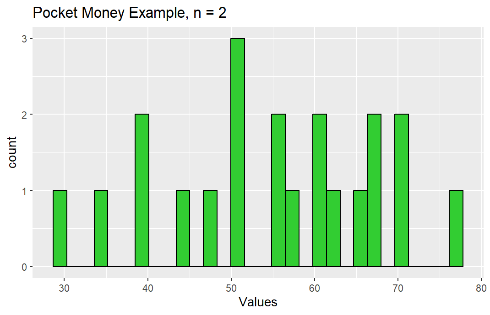
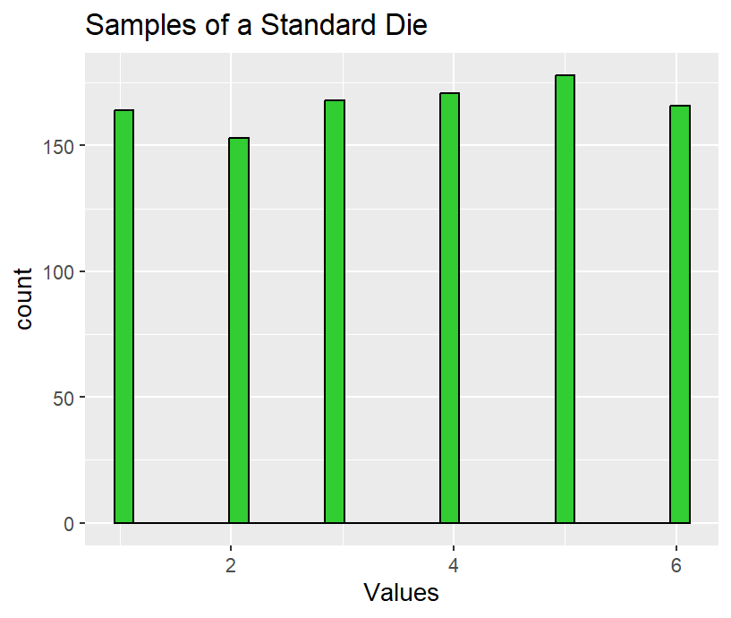
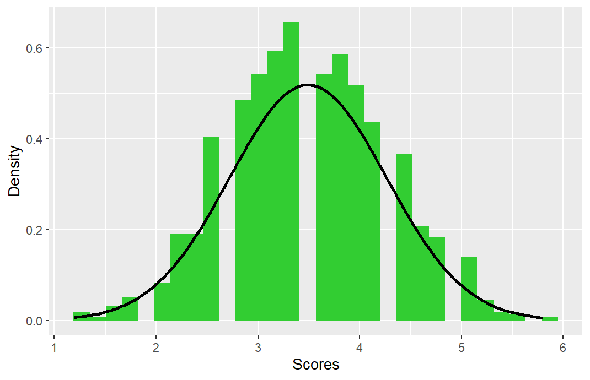

The central limit theorem (CLT) is one of the most important theorems in statistical theory and it provides a foundation
for many applications. In this chapter, we will give a simple introduction of the theorem. 

## A Motivating Example ##

We use a small example to demonstration the key claim in the theorem.

> ### Example: PocketMoney ###
> Suppose we have a population of $7$ secondary students and they got their monthly pocket money as follows (in £):
> $$
>    20, \ 40, \ 50, \ 60, \ 60, \ 75, \ 80.
> $$
> The *population mean* is:
> $$
>   \mu = \frac{20 + 40 + 50 + 60 + 60 + 75 + 80}{7} = 55.
> $$
> We would like to use the *sample mean* to infer the population mean. Can it be done? 

### (a) First Try: ### 
We sample all the pairs (i.e., the sampling size $n=2$) and we get the
following table.

|Sample $\{ x_i\}$       | Sample Mean $\overline{x}$   | Sample $\{ x_i\}$   | Sample Mean $\overline{x}$|
|:------|-------:|-------:|-------:|:------:|:------|
			|20, 40           | 30               | 50, 60       | 55 |
			|20, 50           | 35               | 50, 60       | 55 |
			|20, 60           | 40               | 50, 75       | 62.5 |
			|20, 75           | 47.5             | 50, 80       | 65|
			|20, 80           | 50               | 60, 60       | 60 |
			|40, 50           | 45               | 60, 75       | 67.5 |
			|40, 60           | 50               | 60, 80       | 70 |
			|40, 60           | 50               | 60, 75       | 67.5 |
			|40, 75           | 57.5             | 60, 80       | 70 |
			|40, 80           | 60               | 75, 80       | 77.5 |
			|20, 60           | 40               |              | | 		

There are in total $21$ pairs. The histogram of the sample means $\{ \overline{x}\}$ is plotted
in the figure below.

### (b) Second Try: ### 
In order to see the trend of the distribution of the sampling means, let us increase the sampling size to $n = 6$, which are contained in the next table.
There are in total $7$ samples. The histogram of the sample means $\{ \overline{x}\}$ is plotted
in the following figure.

|Sample $\{ x_i\}$       | Sample Mean $\overline{x}$ |  
|:------:|:-------|
			|20, 40, 50, 60, 60, 75          | 50.1 |
			|20, 40, 50, 60, 60, 80          | 51.6 |
			|20, 40, 50, 60, 75, 80			| 54.1 |
			|20, 40, 50, 60, 75, 80			| 54.1 |
			|20, 40, 60, 60, 75, 80			| 55.8 |
			|20, 50, 60, 60, 75, 80			| 57.3 |
			|40, 50, 60, 60, 75, 80			| 60.8 | 				

We can observe from the two histograms that the means in the second are more "squeezed"
into the region about $54$ than the means in the first figure, which are more "spread". 
The only difference in the cases is that we increased the sampling size from $2$ to $6$.
This is not incidental. This is exactly what the central limit theorem implies.  

## Central Limit Theorem ##

We here describe the central limit theorem mathematically.
Let us first redefine the *Sample Mean*.

> ### Definition: Sample Mean ###
> Let the random variables $X_1, X_2, \ldots, X_n$ denote a random sample from a population
> with the mean $\mu$ and the standard deviation $\sigma$.
> The *sample mean* of these random variables is defined as:
> $$
>    \overline{X} = \frac 1n \sum_{i=1}^n X_i.
> $$ 

We need the following features in the next part of the discussion.

* Since $X_i$'s are random, so is $\overline{X}$. Hence, we can talk about
	the mean and the variance of $\overline{X}$.
* The mean of $\overline{X}$ is the population mean $\mu$ because
$$
	  E[\overline{X}] = \frac 1n E[\sum_{i=1}^n X_i] 
	  = \frac 1n \sum_{i=1}^n E[X_i] = \frac 1n \sum_{i=1}^n \mu = \mu.
$$
	This does not depend on the sampling size $n$.
* Assuming that $X_i$ are independently, identically distributed (i.i.d.),
	then the variance of $\overline{X}$ is
$$
	\begin{align}
    \sigma_{\overline{X}}^2 & = & Var(\overline{X}) \\
    & = & Var \left( \frac 1n \sum_{i=1}^n X_i  \right)  \\ 
		& = & \frac 1{n^2} Var \left( \sum_{i=1}^n X_i  \right) \\
		& = &  \frac 1{n^2} \sum_{i=1}^n Var \left( X_i  \right) \\ 
		& = & \frac 1{n^2} \sum_{i=1}^n \sigma^2 \\
		& = & \frac{\sigma^2}{n}.
    \end{align}
$$ 
The standard deviation of $\overline{X}$ (also known as the *Sample Standard Error*) is
$$
     \sigma_{\overline{X}} = \frac{\sigma}{\sqrt{n}}.
$$
This *does* depend on the sampling size $n$.

We are now ready to state the central limit theorem.

> ### Theorem: Central Limit Theorem ###
> Let $X_1, X_2, \ldots, X_n$ be a set of $n$ independent random variables having identical distributions with the population mean $\mu$ and the variance $\sigma^2$ (i.e., $X_i$'s are i.i.d.).
> Let $\overline{X}$ be the mean of these random variables. Then, as $n$ becomes large, the
> random variable
> $$
>     Z_n = \frac{\overline{X} - \mu}{\sigma_{\overline{X}}}
> $$
> approaches the standard normal distribution.	
 
We can write down some implications of the theorem.

* The random variable $Z_n$ depends on the number of $n$ and is a standardlized 
	random variabe:
	$$
	  E[Z_n] = 0 \qquad \mbox{and} \qquad Var(Z_n) = 1.
	$$
	
* The Central Limit Theorem is used loosely in the following way:
	\begin{align*}
	\overline{X} & \sim N(\mu,\sigma^2/n)\ \ \mbox{for large n} \\
	\sum^n_{i=1}X_i & \sim N(n\mu,n\sigma^2)\ \ \mbox{for large n}.
	\end{align*}
	An important application is to the binomial distribution. Suppose $Y \sim \texttt{bin}(n, p)$.
	Then $Y = \sum_{i=1}^n X_i$, where the $X_i$'s are i.i.d. Bern($p$). 
	The Central 
	Limit Theorem implies
	$$
	  \frac{Y - E[Y]}{\sqrt{Var(Y)}} 
	  = \frac{Y - np}{\sqrt{npq}} \sim N(0,1)
	$$
	when $n$ is large. This is equivalent to saying
	$$
	   Y \sim N(np, npq)
	$$
	and this explains why we usually approximate the binomial distribution for large $n$ by an appropriate normal distribution.
	
* A related and important result is the *Law of Large Numbers*,
	which says that the sample mean will approach the population mean as the sample size $n$
	becomes large regardless of the underlying probability distribution.
	
* In the pocket money example, we use a small example to illustrate the
	key point of the Central Limit Theorem but we could also make use of computer simulation to demonstrate this theorem. 
	The figure below shows the results of tossing a balanced die $N=5000$ times. We can see that the frequency of
	each face value ($1,2,3,4,5,6$) appears roughly equally (around $800$ times).
	Next, we randomly select $1000$ samples of size $5$ . The average mean of each sample of size $5$ is plotted in the second figure. This suggests that the average mean follows a normal distribution.
	We can expect that as $n$ increases, the approximation by the normal distribution becomes better.
	

## Sample Variances ##

We now know that the sample mean approaches a normal distribution as the sampling size grows. What about the sample variance? 

> ### Definition: Sample Variance ###
> Let $X_1, \ldots, X_n$ be a random sample from a population with the population $\mu$ and
>  variance $\sigma$. The quantity
> $$
>   S^2 = \frac{1}{n-1} \sum_{i=1}^n ( X_i - \overline{X})^2
> $$
> is called the *sample variance*, and its square root $S$ is called the 
> sample standard deviation.

If we sample $X$ with the values $x_1, \ldots, x_n$, then $s^2$
would be a good estimate for $\sigma^2$, where
$$
 s^2 = \frac{1}{n-1} \sum_{i=1}^n (x_i - \bar{x})
$$
and $\bar{x}$ is the sample mean
$$
  \bar{x} = \frac 1n (x_1 + \ldots + x_n).
$$

When the underlying population follows a normal distribution, then we can say
more about the distribution of $S^2$.

Suppose $X_1, \ldots, X_n$ are a random sample from a r.v. $X$, which has a normal distribution with the population variance $\sigma^2$. Then the new random variable
$$
  Y = \frac{(n-1) S^2}{\sigma^2} = \frac{\sum_{i=1}^n (X_i - \overline{X})^2}{\sigma^2}
$$
follows the distribution $\chi^2_{n-1}$.

## Examples ##

In this part, we use a few examples to illustrate the use of the Central Limit Theorem. The first example is on a continuous distribution.

> ### Example: Exponential Distribution ###
> Suppose $X_1, X_2, \ldots, X_n$ with $n = 25$ are i.i.d, each following Exp($\lambda$) with 
> $\lambda = 1/100$. Use the Central Limit Theorem to estimate $P (90 \le \overline{X} \le 110)$, where $\overline{X}$ is the mean of the sample:
> $$
>    \overline{X} = \frac 1n \sum_{i=1}^n X_i.
> $$

### Solution ###
It follows from the equations for the sample mean and sample variance that the
expectation of the sample mean is
$$
  E[\overline{X}] = E[X_i] = \frac 1{\lambda} = 100
$$
and the variance of the sample mean is
$$
 Var(\overline{X}) = Var(X_i)/n = \frac{1}{n\lambda^2} = 400.
$$

It follows from the Central Limit Theorem that
$$
\begin{align}
  P(90 \le \overline{X} \le 110) & & \\ 
 &\approx & P \left(
     \frac{90 - E[\overline{X}]}{\sqrt{Var(\overline{X})}} \le
     \frac{\overline{X} - E[\overline{X}]}{\sqrt{Var(\overline{X})}}
     \le \frac{110 - E[\overline{X}]}{\sqrt{Var(\overline{X})}} 
  \right) \\ 
  &=& P \left(
  \frac{90 - 100}{20} \le
  Z
  \le \frac{110 - 100}{20} 
  \right) \\ 
  &=& P \left(
  - \frac{1}{2} \le
  Z
  \le \frac{1}{2} 
  \right) = 2 \Phi(1/2) - 1 = 0.383. % note: \Phi(1/2) = 0.6915
  \end{align}
$$

> ### Example: Range of the Mean ###
> Suppose $X_1, X_2, \ldots, X_n$ with $n = 25$ are i.i.d from some distribution with the population
> mean $\mu = 100$ and the standard deviation $\sigma = 100$.
> Use the Central Limit Theorem to estimate $P (90 \le \overline{X} \le 110)$, where $\overline{X}$ is the mean of the samples:
> $$
> \overline{X} = \frac 1n \sum_{i=1}^n X_i.
> $$

### Solution ###
The solution matches that for the first example as the CLT does not rely on whether or not the data
came from the exponential distribution. We just need the mean and the variance.

> ### Example: Southampton Football Club ###
> 	Southampton Football Club play $38$ independent games every season. 
> 	each of the games they have probability $0.7$ of winning.
> 	What is the probability they win at least $25$ games?

### Solution ### 
Note that we assumed that each game is independent with the winning probability
of $p = 0.7$. That is, $Y \sim bin(38, 0.7)$. We need to calculate
$P (Y \ge 25)$. We now use the CLT to approximate this probability. 

$$
\begin{align}
 P (Y \ge 25) && \\ 
&\approx& P  \left(
Z \ge \frac{25 - np}{\sqrt{npq}} \right) \\ 
&=& P \left(
Z \ge \frac{25 - 26.6}{\sqrt{7.98}} \right) \\ 
&=& P \left(
Z \ge \frac{25 - 26.6}{\sqrt{7.98}} \right) \\ 
&=& P \left(
Z \ge -0.5664 \right) = P \left(
Z \le 0.5664 \right) \approx 71.57\%.
\end{align}
$$

Second Solution: 
$$ 
    \begin{align}
	 P (Y \ge 25) & = &  P (Y \ge 25 - 0.5) 
	     \qquad (\mbox{``Continuity correction''})  \\ 
	&\approx& P  \left(
	Z \ge \frac{24.5 - np}{\sqrt{npq}} \right) \\ 
	&=& P \left(
	Z \ge \frac{24.5 - 26.6}{\sqrt{7.98}} \right) \\ 
	&=& P \left(
	Z \ge \frac{24.5 - 26.6}{\sqrt{7.98}} \right) \\ 
	&=& P \left(
	Z \ge -0.7434 \right) = P \left(
	Z \le 0.7434 \right) \approx 77.04\%.
    \end{align}
$$

The reason why we used the "continuity correction" is that we are using a continuous
random variable to approximate a discrete random variable. But it is just a practice to 
make the approximation more "reasonable" or "justifiable".

> ### Example: BMW Dealership ###
> BMW plans to sponsor a new dealer in the city of Xuzhou, China.
> Existing research suggests that the deal will be successful in cities of this size
> if the mean annual family income is above $120,000$ RMB (Chinese currency).
> It is also assumed that the standard deviation of income is $60,000$ RMB in Xuzhou.
> A random sample of $100$ people was obtained and the mean income of the sample is
> $128, 200$ RMB. Does this sample provide evidence to conclude that a dealer should be
> sponsored? 

### Solution ### 
The Central Limit Theorem implies that the sample mean follows a normal distribution. This enables us to estimate the probability of the sample mean bigger than
$128,000$ RMB if the population mean is $\mu = 120,000$.

$$
\begin{align}
	 P (\overline{X} \ge 128000) && \\ 
	&\approx & P \left(
	\frac{\overline{X} - E[\overline{X}]}{\sqrt{Var(\overline{X})}}
	\ge \frac{128000 - E[\overline{X}]}{\sqrt{Var(\overline{X})}} 
	\right) \\ 
	&=& P \left(
	Z
	\ge \frac{128000 - 120000}{\sigma/\sqrt{100}} 
	\right) \\ 
	&=& P \left(
	Z
	\ge 1.33  
	\right) = 1 - \Phi(1.33) = 1 - 0.9082 = 0.0918. 
\end{align}
$$
