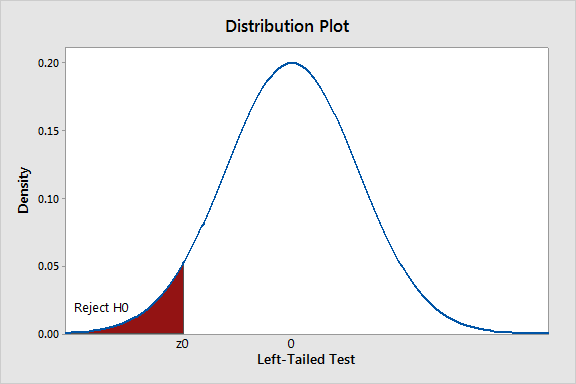
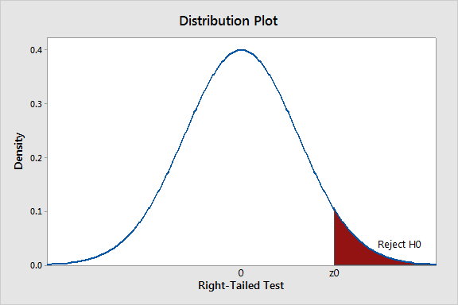
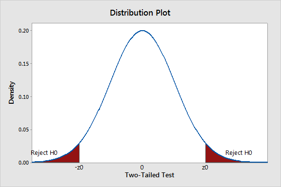

## Concepts of Hypothesis Testing ##

Hypothesis tests are used to determine whether a result is real or has happened by chance. It is not possible to claim this with certainty and consequently hypothesis tests have a probability associated with them.
We describe the basic process of a hypothesis test below.

1. Make a claim (e.g. the mean is less than or equal to some critical value) denoted by $H_0$ and an alternative claim (the mean is greater than the same critical value), denoted by $H_{1}$.	
2. Develop a test statistic $T$, which is based on $H_0$ being true and on the sample data.
4. Check whether your statistic $T$ satisfies the conditions laid out in part 1 at a given significance level (typically $\alpha = 0.05$).

> ### Example: Breakfast Bars ###
> In order to meet professional regulations, the manufacturer of breakfast bars should make sure each of the produced bars weights more than $42$g.
> How could the company use sample data to check if it has met this target?

1. Set up a hypothesis test such that
	$$
	   H_0 \qquad   \mu \le \mu_0 = 42
	$$
and the alternative is
	$$
	  H_1 \qquad   \mu > 42.
	$$
2. Develop a test statistic $T$. For example, it could be
	$$
	   Z = \frac{\overline{X} - \mu_0}{\sigma/\sqrt{n}}.
	$$
Here, $Z$ depends on $H_0$ (the value of $\mu_0$ assumed) and the sample used to determine $\overline{X}$ (assuming $\sigma$ is known).
3. Check whether the statistic has met the standard at a given significance level and conclude that the test shows either: (i) Fail to reject $H_0$ or (ii) Reject $H_0$.

In what follows we define the new concepts used in the test procedure.

> ### Definition: Null and Alternative Hypothesis ###
> A *null hypothesis* often represents a status quo, that will be maintained unless there is strong evidence against it.
> If we reject the null hypothesis, then the second hypothesis, known as the *alternative hypothesis*, will be accepted.

> ### Definition: Test Statistic ###
> In hypothesis testing, a *test statistic*, often denoted by $T$, is developed based on
> the null hpothesis and a sample. Usually, the distribution of $T$ is also known and this allows us to match with a significance level.	

> ### Definition: Significance Level ###
> The *significance level*, $\alpha$, denotes the probability of rejecting $H_0$ if $H_{0}$ is true.
> Typically $\alpha = 0.05$ or $5\%$.

Interpreting the result of a hypothesis test requires care.

* If there is strong evidence to reject $H_0$, we accept the alternative $H_1$. If there is not enough evidence to reject $H_0$, we say that we *fail to reject $H_0$* 
	(Note: we do not say that we accept $H_0$ in this case).
* When we fail to reject $H_0$, either the null hypothesis or the alternative might be true.
* The choice of test statistic depends on the information available and the hypothesis.
* The significance level is also known as *Type I Error* (the probability of rejecting $H_0$ when it is actually true). *Type II Error* is the probability of failing to reject $H_0$ when it is actually false.

## Types of Hypothesis Tests ##

We will consider five types of hypothesis tests in this module.

1. Testing the mean of a single population $E[X] = \mu$ $(H_0: \mu = \mu_0$; $H_1: \mu \neq \mu_0$ or $\mu < \mu_0$ or $\mu > \mu_0)$.
2. Testing the variance of a single population $Var(X) = \sigma^2$ ($H_0: \sigma^2 = \sigma^2_0$; $H_1: \sigma^2 \neq \sigma^2_0$ or $\sigma^2 < \sigma^2_0$ or $\sigma^2 > \sigma^2_0$).
3. Comparing the means of two populations $E[X] = \mu_X$ and $E[Y] = \mu_Y$ ($H_0: \mu_X = \mu_Y$; $H_1: \mu_X \neq \mu_Y$ or $\mu_X < \mu_Y$ or $\mu_X > \mu_Y$).
4. Comparing the variances of two populations $Var(X) = \sigma^2_X$ and $VarY = \sigma^2_Y$ ($H_0: \sigma^2_X = \sigma^2_Y$; $H_1: \sigma^2_X \neq \sigma^2_Y$ or $\sigma^2_X < \sigma^2_Y$ or $\sigma^2_X > \sigma^2_Y$).
5. Testing the proportion $p$ of successes in a binomial trial ($H_0: p = p_0$; $H_1: p \neq p_0$ or $p < p_0$ or $p > p_0$).

All hypothesis tests follow a common methodology. The *null hypothesis*, $H_0$,
specifies a particular value for the statistic (mean/variance/proportion/etc), whereas the *alternative hypothesis*,
$H_1$, usually specifies a range of alternative values. The null hypothesis is conservative
and represents the status quo, a theory that we want to give priority to or the hypothesis
of no-change. It is the default state. 

The alternative hypothesis $H_1$ represents a feasible alternative to $H_0$. It is one-sided
or two-sided, and accordingly the test is called a one-sided (one-tailed) or two-sided
(two-tailed) test.

### Test Statistics ###

One of the important tasks in hypothesis testing is to
form a test statistic $T$, and determine its distribution under $H_0$.
We assume $H_0$ is true when finding the distribution for the test statistic $T$. Using the same numbering as above for the different types of hypothesis test, we can write down the relevant test statistics.

1. *Test statistic in the hypothesis testing about a population mean*
$$
H_0: \qquad \mu = \mu_0.
$$
	(a) $\sigma$ known
	$$
	T = \frac{\overline{X}-\mu_0}{\sigma/\sqrt{n}}\ \approx \ N(0,1) \ \ \mbox{by CLT for n sufficient large;}
	$$
	(b) $\sigma$ unknown
		$$
		T = \frac{\overline{X}-\mu_0}{S/\sqrt{n}} \left\{
		\begin{array}{ll}
		\approx N(0,1)\qquad & \mbox{by CLT for} \ n \geq 100\\ [0.8ex]
		\sim t_{n-1}\qquad & \mbox{if $X_i$ are normal.}
		\end{array}
		\right.
		$$
2. *Test statistic in the hypothesis testing about the means of two populations*

	$$
	   H_0: \qquad \mu_X = \mu_Y.
	$$
	(a) Known variances $\sigma_1$ and $\sigma_2$

		$$
		T = \frac{\overline{X} - \overline{Y} - (\mu_X - \mu_Y)}{\sqrt{\sigma_1^2 /n_X + \sigma_2^2 /n_Y}} \approx \  N(0,1).
		$$
    (b) Unknown variances

		Let us define (pooled variance) $S^2_p = ((n_X - 1)S^2_X + (n_Y - 1)S^2_Y)/(n_X +n_Y - 2)$.
		$$
		T = \frac{\overline{X} - \overline{Y}}{\sqrt{S^2_p(\frac{1}{n_X} + \frac{1}{n_Y})}} \sim t_{n_X + n_Y - 2}
		$$
		if $X_i$ and $Y_i$ are normally distributed.
3. *Test statistic in the hypothesis testing about a variance in a single population*
    $$
    T = \frac{(n-1)S^2}{\sigma^2_0} = \frac{1}{\sigma^2_0} \sum^2_{i=1}(X_i-\overline{X})^2 \ \sim \ \chi^2_{n-1},
    \ \ \ \mbox{if $X_i$ are normal;}
    $$

### Rejection Region ###

> ### Definition: Rejection Region ###
> A *rejection region* (or *critical region*) of the sample test statistic $T$ is the range of values for which the null hypothesis is not probable.
In particular, for a given significance level $\alpha$, the rejection or critical region $C$ is computed as follows.

For the left-tailed test,
	$$
	   C = (-\infty, \; t_\alpha),
	$$
	where $t_\alpha$ is decided by
	$$
	 P(T \le t_\alpha) = \alpha.
	$$
For the right-tailed test,
	$$
	C = ( t_\alpha, \ \infty),
	$$
	where $t_\alpha$ is decided by
	$$
	P(T \ge t_\alpha) = \alpha.
	$$
For the two-tailed test,
	$$
	C = (-\infty, \; t_{\alpha/2}) \cup (t_{1-\alpha/2}, \ \infty),
	$$
	where $t_{\alpha}$ and $t_{1-\alpha/2}$ are respectively decided by
	$$
	P(T \le t_{\alpha/2}) = \frac 12 \alpha \qquad \mbox{and} \qquad
	P(T \ge t_{1-\alpha/2}) = \frac 12 \alpha.
	$$

The rejection region is illustrated in the three figures below.

If the sample statistic $t \in C$, then reject $H_0$. If the sample statistic $t \not\in C$, then fail to reject $H_0$.

We can think of the rejection region as the set of all values of the test statistic that cause us to reject the null hypothesis, 
where the significance level $\alpha$ is the probability that the test statistic will fall in the rejection region when 
	the null hypothesis is actually true (Type I error). Failing to reject the null hypothesis does not mean that we have accepted the null hypothesis as true. We just do 
	not have enough evidence to reject the null hypothesis.

### $p$-Values ###

> ### Definition: $p$-value or Probability value ###
> Assume that the null hypothesis is true, a sample test statistic $T$ is available and its 
> sample value is $t$. The $p$-value of $T$ at $t$ is the probability that the test statistic $T$
> is worse than the observed value $t$. In particular,
> 
> 1. the left-tailed test
> 	$$
> 	  p = P(T < t);
> 	$$
> 2.  the right-tailed test
> 	$$
> 	 p = P(T > t);
> 	$$
> 3.  the two-tailed test
> 	$$
> 	p = 2 \times \min \{ P(T < t), \ P(T>t) \}.
> 	$$

To use  a p-value to make a decision in a hypothesis test, compare the p-value with the significance level $\alpha$.
If $p \leq \alpha$, then reject $H_0$ and if $p > \alpha$, then fail to reject $H_0$.

This means that a small p-value indicates that the observed test statistic would be 
unlikely if the null hypothesis were true. The lower the p-value, the more evidence there is in favour of rejecting the null hypothesis.
The following
table gives a summary of possible results of any hypothesis test:

| | $H_0$ is true | $H_0$ is false|
|:------|-------:|-------:|
|Fail to reject $H_0$ | Correct decision | Type II error |
|Reject $H_0$ | Type I error | Correct decision|
		 
Type I errors are considered to be more serious and therefore more important to avoid.
The probability of committing both types of errors can be reduced by increasing the
sample size.

## Examples ##

We now use a number of examples to demonstrate the steps in a hypothesis test.

### Test of the mean of a normal distribution: population variance known ###

> ### Example: Breakfast Bars ###
> It is known that the weights (in grams g) of breakfast bars produced by a food company follow a
> normal distribution with standard deviation $\sigma = 0.4g$.
> The company would like to make sure each of the produced bars weights over $42$g.
> The company sampled $36$ bars and the sample mean is $42.3$g. At the significance level $\alpha = 5\%$,
> would the company be able to conclude that each of its produced bars weights over $42$g? 
	
The null hypothesis is: $H_0 : \mu = \mu_0 = 42$. 

The alternative hypothesis is:  $H_1 : \mu > 42$ (right-tailed test). 
	
The test statistic $T$ can be written as
	$$
	T = \frac{\overline{X} - \mu_0}{\sigma/\sqrt{n}}  = \frac{\overline{X} - 42}{0.4/\sqrt{36}} \ \sim \ N(0,1).
	$$
We can either determine the rejection region or use a calculated p-value to make a decision. Below we consider each in turn.

The rejection region is given by
			$$
			C =  (z_\alpha, \ \infty),
			$$
			where $z_\alpha$ is defined by
			$$
			P(T \geq  z_\alpha ) = \alpha = 0.05.
			$$
Using the statistical table for the standard normal distribution, we know that
			$$
			  z_\alpha = z_{0.05} = 1.6449.
			$$
So the rejection region is     	
			$$
			C =	(1.6449,\ \infty).
			$$
For this problem, we can evaluate $t$ as	
			$$
			t = \frac{42.3-42}{0.4/\sqrt{36}} = 4.5.
			$$
We can see that $t \in C$ (the sample statistic lies in the
			rejection region), hence we *reject the null hypothesis*.
			
If we instead find the p-value, we use
			$$
			    p  = P( T > 4.5) = 0.0005.
		    $$
The p-value, $p < \alpha = 0.05$, therefore we reject $H_0$.

The rejection region can be equivalently stated for the sample mean $\overline{X}$:
$$
 C = \left(
   \mu_0 + z_\alpha \times \frac{\sigma}{n}, \ \infty
 \right) = (41.0966, \ \infty).
$$
The observed sample mean is $42.3$, which  obviously falls in above region. Hence we reject $H_0$, as we did above.

Even if the population does not follow a normal distribution, we can still use the $Z$ test as long as the sample size $n$ is large enough.

### Test of the mean of a normal distribution: population variance unknown ###

> ### Example: Children Walking 
> A psychologist claims that the mean age at which children start walking
> is $12.5$ months. In order to check this claim another researcher takes a sample of $20$ children.
> In the sample the mean age for walking is $12.9$ months, and the standard deviation is $0.8$ months. 
> It is known that the ages at which children start walking is approximately normally distributed.
> What would you conclude for a significance level of $5\%$?

We can test whether the sample agrees with the assumed mean of $12.5$ months using a hypothesis test.
From the information given, we have
$$
  \mu_0 = 12.5, \quad n = 20, \quad  \bar{x} = 12.9, \quad s = 0.8, \quad \alpha = 5\%.
$$

The null hypothesis: $H_0 : \mu = \mu_0 = 12.5$
	
The alternative hypothesis: $H_1 : \mu \neq 12.5$ (two-tailed test)
	
The test statistic $T$,
	$$
	T = \frac{\overline{X} - \mu_0}{S/\sqrt{n}}  = \frac{\overline{X} - 12.5}{S/\sqrt{20}} \ \sim \ t_{n-1} = t_{19}.
	$$
We can either find the rejection region or calculate the p-value in order to make a decision.

The rejection region is given by	  
       	 $$
       	    C = (-\infty, \ - t_{19, \alpha/2}) \cup (t_{19, \alpha/2}, \ \infty),
       	 $$
where $t_{19, \alpha/2}$ is defined by
       	$$
       	   P(T \ge  t_{19, \alpha/2} ) = \frac 12 \alpha = 0.025.
       	$$
Using the statistical table for the $t$ distribution, we have
       	$$
       	  t_{19, 0.025} = 2.093.
       	$$
So the rejection region is     	
       	$$
          C =	(-\infty, -2.093)\cup(2.093, \infty).
	    $$
Note that because the distribution of $t$ is symmetric about $0$, the two tails are also symmetric. 
	
Calculating the observed value $t$ for the statistic T,
	$$
	t = \frac{12.9-12.5}{0.8/\sqrt{20}} = 2.236.
	$$
This shows that $t \in C$ (the sample statistic lies in the
	rejection region), hence we *reject the null hypothesis*.
	
If we instead calculate the p-value, 
	       \begin{align*}
             	p & = P(T< -2.236) + P(T > 2.236) = 2P(T > 2.236) \\
                               & = 2(1-P(T<2.236)) = 2(1-0.9753) = 0.0494.
		   \end{align*}
	
We can see that $p < \alpha = 0.05$, hecne we reject $H_0$.
	  
As above, the rejection region can be equivalently stated for the sample mean $\overline{X}$:
	 \begin{eqnarray*}
	  C &=& \left(
	    -\infty, \ \mu_0 - t_{n-1, \alpha/2} \times \frac{s}{\sqrt{n}}
	  \right) \cup 
	  \left(
	   \mu_0 + t_{n-1, \alpha/2} \times \frac{s}{\sqrt{n}}, \ \infty
	  \right)  \\ 
	  &=& (-\infty, \ 12.5-0.3744) \cup (12.5 + 0.3744, \ \infty)  \\ 
	  &=&	  (-\infty, \ 12.1256) \cup (12.8744, \ \infty).
	 \end{eqnarray*}
    The observed mean is $12.9$, which obviously falls in the rejection region. Hence, reject $H_0$. 

### Test of the Population Proportion (Large Samples) ###

We have stated before that the distribution of the sample proportion can be reasonably 
 accurately approximated by the normal distribution. Therefore, the test framework
goes as follows.

If the null hypothesis is that the population proportion is $P_{0}$ then
$$
   H_0: \qquad P = P_0,
$$
then the test statistic $T$ 
$$
   T = \frac{\hat{P} - P_0}{\sqrt{P_0(1-P_0)/n}} \ \sim \ N(0,1),
$$
when $nP_0(1-P_0) > 5$. For a given significance level $\alpha$, let $z_\alpha$ be defined by
$$
  \mbox{Prob}( T > z_\alpha) = \alpha.
$$
We can consider the following three types of tests.

1. *Left-tailed test*. The null hypothesis is
	$$
	   H_0: \qquad P = P_0 \qquad \mbox{or} \qquad H_0: \qquad P \ge P_0.
	$$
	The alternative is
	$$
	  H_1: \qquad P < P_0.
	$$
	The decision rule is
	$$
	 \mbox{if} \ \ \frac{\hat{p} - P_0}{\sqrt{P_0(1-P_0)/n}} < - z_\alpha
	 \qquad \mbox{then reject }\ H_0. 
	$$
2. *Right-tailed test*. The null hypothesis is
  $$
  H_0: \qquad P = P_0 \qquad \mbox{or} \qquad H_0: \qquad P \le P_0.
  $$
  The alternative is
  $$
  H_1: \qquad P > P_0.
  $$
  The decision rule is
  $$
  \mbox{if} \ \ \frac{\hat{p} - P_0}{\sqrt{P_0(1-P_0)/n}} > z_\alpha
  \qquad \mbox{then reject }\ H_0. 
  $$
3. *Two-tailed test*. The null hypothesis is
  $$
  H_0: \qquad P = P_0.
  $$
  The alternative is
  $$
  H_1: \qquad P \not= P_0.
  $$
  The decision rule is
  $$
  \mbox{if} \ \ \frac{\hat{p} - P_0}{\sqrt{P_0(1-P_0)/n}} < - z_{\alpha/2}
  \ \ \mbox{or} \ \ \frac{\hat{p} - P_0}{\sqrt{P_0(1-P_0)/n}} >  z_{\alpha/2}
  \qquad \mbox{then reject }\ H_0. 
  $$

We can define the p-value in a similar way to the previous two sections.

> ### Example: SUSU Shop
> The student union shop at a university would like to know whether students are sensitive
> to the prices of items sold in its shop. A random sample of $500$ students was obtained
> and $238$ of them were able to state the correct price of an item immediately after putting
> it in their basket. Test at the $5\%$  significance level the null hypothesis that at least $50\%$ of the students are able to state the correct price.	

The null hypothesis is
$$
  H_0: \qquad P \ge P_0 = 0.50
$$
and the alternative is
$$
  H_1: \qquad P < 0.50.
$$
For this example, we have
$$
  n = 500, \quad \hat{p} = \frac{238}{500} = 0.476, \quad \alpha = 0.05.
$$
Hence, $z_\alpha = -1.6449$ (from the statistical tables) and the rejection region is
$$
  C = (-\infty, \ -1.6449).
$$
The observed test statistic is
$$
  z = \frac{\hat{p} - P_0}{\sqrt{P_0(1-P_0)/n}} 
  = \frac{0.476 - 0.5}{\sqrt{0.5(1-0.5)/500}} = -1.0733.
$$
It lies outside of the rejection region. Therefore, there is not enough evidence to
reject $H_0$ (Fail to reject $H_0$).

### Two-Tailed Significance Tests for Population Mean and Confidence Intervals ###

Recall the confidence interval introduced before. We construct an interval that would
include the true value of the population mean $\mu$ with a specified probability $C$.
For example, suppose we use a $C = 95\%$ confidence interval.
Then the values of $\mu$ are not in our interval would seem to be incompatible with the data.
This sounds like a significance test with $\alpha = 1-C= 0.05$. We use an example studied before to 
demonstrate that this interpretation is correct.

> ### Example: Waiting Times ###
> Suppose that the waiting times for students at a university student service centre are 
> normally distributed with known population standard deviation of $18$ minutes.
> A random sample of $81$ students in the centre has a mean waiting time of $25$ minutes.
> The $C=95\%$ significance interval was found to be
> $$
>   \mbox{CI} = (21.08, \ 28.92).
> $$
> Now we would like to test whether the true mean $\mu$ is the value of $21$ at
> the significance level $\alpha = 1-C = 5\%$.
> Based on the CI, $21$ is not in the interval, hence we would say with $95\%$ confidence, $21$ is the not the true value of $\mu$. What can we say from the hypothesis testing perspective?

 We would like to test the claim
$$
H_0: \qquad \mu = \mu_0 = 21 \qquad \mbox{against} \qquad H_1: \qquad \mu \not= \mu_0.
$$
From the example, we have
$$
  \bar{x} = 25, \quad \sigma = 25, \quad n=81.
$$
The test statistic is
$$
   Z = \frac{\overline{X} - \mu_0}{\sigma/\sqrt{n}} \ \sim \ N(0,1)
$$
and this is a two-tailed test.
The critical value $z_{\alpha/2}$ is given by
$$
 P(Z \ge z_{\alpha/2}) = \frac{\alpha}2 = 0.025 \qquad \Longrightarrow \qquad 
 z_{\alpha/2} = 1.96.
$$
The rejection region is
\begin{eqnarray*}
	C &=& (-\infty, \ -z_{\alpha/2}) \cup (z_{\alpha/2}, \ \infty) \\
	  &=& (-\infty, \ -1.96) \cup (1.96, \infty).
\end{eqnarray*} 
The observed $z$-statistic is
$$
  z = \frac{25-21}{18/\sqrt{81}} = \frac 42 = 2.
$$
Obviously, $z\in C$, and we reject $H_0$ in favour of $H_1$.

###  (Optional) The Power of a Test ###
We first explain why we need to find the *power* of a test and why it is useful. 
Suppose we would like to test the mean of a normal distribution
$$
  H_0: \quad \mu = \mu_0 \quad \mbox{against} \quad
  H_1: \quad \mu > \mu_0.
$$
We have seen that we can use the decision rule (by finding the rejection region)
$$
 \mbox{Reject} \ H_0 \ \ \mbox{if} \
 z = \frac{\bar{x} - \mu_0}{\sigma/\sqrt{n}} > z_\alpha
$$
or equivalently
$$
 \mbox{Reject} \ H_0 \ \ \mbox{if} \ \bar{x} > \bar{x}_c = \mu_0 + z_\alpha \frac{\sigma}{\sqrt{n}},
$$
where $z_\alpha$ is the critical value in this test and is computed by
$$
  P(Z \ge z_\alpha) = \alpha.
$$
Now suppose $H_0$ is not true. If we reject it, then we make a correct decision.
But if we fail to reject it, then we committed a Type II error. The question is how big this
Type II error is and how to compute it.

Suppose the true mean is $\mu = \mu^* > \mu_0$ so that $H_0$ is false. The Type II error
is the probability that the sample mean $\bar{x}$ will be in the non-rejection region of
the null hypothesis (so that we failed to reject $H_0$). This probability is 
the Type II error associated with $\mu^*$ and denoted by $\beta$:
$$
 \beta = P( \overline{X} < \bar{x}_c \ | \ \mu = \mu^*)
 = P \left(
 Z < \frac{\bar{x}_c - \mu^*}{\sigma/\sqrt{n}}
 \right). 
$$
The power of this test is defined by
$$
  \text{Power of Test} = 1 - \beta.
$$
The value of $\beta$ and the power will be different for every $\mu^*$.

We now give an example that summarises what we have learned so far.

> ### Example: Fast Food Chain ###
> Each day, a fast-food chain tests that the average weight of its "Twin-pounders" is at
> least $32$ ounces ($H_0: \ \mu \ge 32$). The alternative is $H_1: \ \mu < 32$, indicating
> that new processing procedures are needed. The weights of twin-pounders can be assumed to be
> normally distributed, with a standard deviation of $3$ ounces ($\sigma = 3$).
> The decision rule adopted is to reject the null hypothesis if the sample mean weight is
> less than $30.8$ ounces.
> If a random sample of (i) $n=36$ or (ii) $n=9$ twin-pounders are selected, what is the probability of a Type I error, using this decision rule?
> (iii) Suppose that the true mean weights is $31$ ounces. If random sample of $36$ twin-pounders are selected,
> what is the probability of a Type II error, using the decision rule?

The decision rule used in the example is
$$
 \mbox{Reject} \ H_0 \ \ \mbox{if} \ \bar{x} < \bar{x}_c = 30.8.
$$

(i) The test statistic is
	$$
	  Z = \frac{\overline{X} - \mu_0}{\sigma/\sqrt{n}} \ \sim \ N(0,1).
	$$
	Let the Type I error be $\alpha$ (the significance level used in the decision rule).
	Then the critical value $\bar{x}_c$ satisfies:
	$$
	  \bar{x}_c = \mu_0 + z_\alpha \frac{\sigma}{\sqrt{n}} = 32 + z_\alpha \times \frac 12,
	$$
	which yields
	$$
	  z_\alpha = -2.4.
	$$
	Therefore
	$$
	 \alpha = P(Z \le -2.4) = 1 - P(Z \le 2.4) = 1-0.9918 = 0.0082.
	$$
	Type I error is $\alpha = 0.82\%$.
	
(ii) Similar to (i) but with $n=9$, we can compute
	$$
	30.8= \bar{x}_c = \mu_0 + z_\alpha \frac{\sigma}{\sqrt{n}} = 32 + z_\alpha,
	$$
	which yields
	$$
	z_\alpha = -1.2.
	$$
	Therefore
	$$
	\alpha = P(Z \le -1.2) = 1 - P(Z \le 1.2) = 1-0.8849 = 0.1151.
	$$
	Type I error is $\alpha = 11.51\%$.

(iii) In this case, the true mean is $\mu^* = 31$. We compute the Type II error as follows.
	\begin{eqnarray*}
		\beta &=& P (\overline{X} \le \bar{x}_c \ | \ \mu = \mu^*) \\ 
		&=&  P \left(
		Z < \frac{\bar{x}_c - \mu^*}{\sigma/\sqrt{n}}
		\right) \\ 
		&=&  P \left(
		Z < \frac{30.8 - 31}{3/6}
		\right) = P (Z < -0.4) \\ 
		&=& 1 - P(Z \le 0.4) = 1-0.6554 = 0.3446 = 34.46\%.
	\end{eqnarray*}

