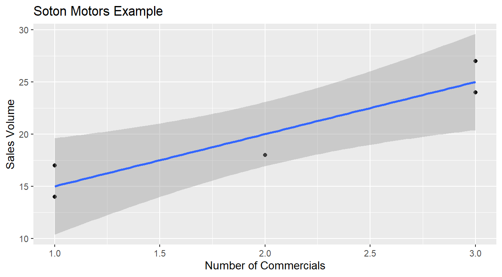
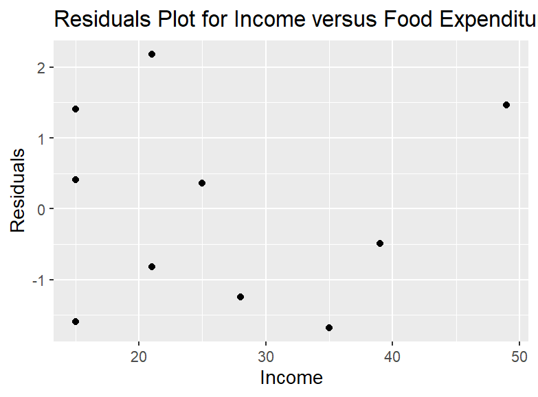
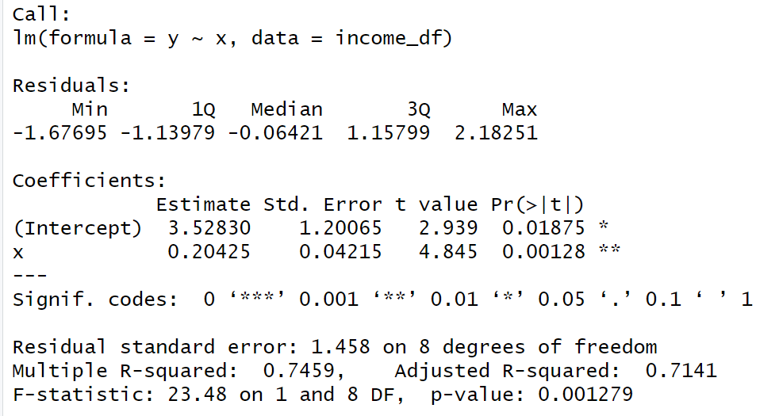

## Introduction ##

Let us start with an example. Consider a sample of households where information on
the incomes and food expenditures for a month (in hundreds of £s) is given in the table
below:

| Income  $X$ | 35 | 49 | 21 | 39 | 15 | 28 | 25 |
|:------|-------:|-------:|-------:|-------:|-------:|-------:|-------:|
Expenditure $Y$ | 9 | 15 | 7 | 11 | 5 | 8 | 9 |

Food expenditure can be seen as a dependent variable $(Y)$ or *response* and the income
$(X)$ is an *independent variable* or *regressor*. If we believe the relationship between $X$
and $Y$ to be linear we can write
$$
Y = \beta_{0} + \beta_{1} X + \varepsilon,
$$
where $\beta_0$ and $\beta_1$ are parameters of the model and $\varepsilon$ is a random variable called the *error term*.
This equation can also be described by the *regression model*.

The relationship is not deterministic but of probabilistic nature, i.e., a given $X$ does not
always give the same value for $Y$. The concept of regression deals with 

* identifying the most accurate relationship between $Y$ and $X$,
* quantifying the strength of the relationship,
* developing methods that allow prediction of the response values $Y$ given values of regressor $x$.

In many applications there are more than one regressor but we will be dealing only
with simple linear regression, the case with only one independent variable or regressor.

We denote a random sample of size $n$ as
$$
(x_1,y_1), (x_2,y_2),..., (x_n,y_n)
$$
and for the same value of $x$ we may expect different values for $y$. Hence $y_i$ in the ordered
pair $(x_i, y_i)$ is a realization of some random variable $Y_i$.
In this chapter, we will discuss the following topics in simple linear regression.

1. Simple Linear Regression Model
2. Least Squares Methods
3. Coefficient of Determination
4. Model Assumptions
5. Testing for Significance

## Simple Linear Regression Model ##
The error term $\varepsilon$ is assumed to have a zero mean. As a result,
$$
E(Y | X = x) = \beta_0 + \beta_1 x.
$$
The graph of the regression equation is a straight line where $\beta_0$ is the $y$ intercept of the
regression line and $\beta_1$ is the slope of the regression line. $E(Y|X=x)$ is the expected value of
$Y$ for a given value of $x$.
Regression models help to understand how two (or more) variables depend on each
other and to predict the value of one variable on the base of the value(s) of another
variable(s).

For the example of food expenditure and income, $X$ represents income and $Y$ food expenditure; therefore $Y$ is a *dependent variable*
or *response*, and $X$ is an *independent variable* or *regressor* or *explanatory variable*.
Independent or explanatory variables are variables which help to explain the variations
in the dependent variable. A *dependent variable* or *response* depends on
independent variable(s).

A *regression model* is a mathematical equation that describes the relationship between
two or more variables. In *multiple regression*, we study the effect of two or more
variables on a dependent variable using regression analysis. In *simple regression*. we consider
only two variables: independent and dependent.
A simple regression model that gives a straight line relationship between two variables
is called a simple *linear regression model*.


The *estimated simple linear regression equation* is the equation
$$
\hat{y} = \hat{\beta}_0 + \hat{\beta}_1 x,
$$
where $\hat{y}$ is the estimated value of $y$ for a given $x$ value.
Next we describe the method of least squares, an estimation process for determining the best-fit parameters of the regression model, $\hat{\beta}_{0}, \hat{\beta}_{1}$ and consequently $\hat{y}$.

## The Method of Least Squares ##
Least Squares Criterion
$$
\min \  Q(\beta_{0}, \beta_1) = \sum^n_{i=1} (y_i-\hat{y}_i)^2
                          =  \sum_{i=1}^n (y_i - \hat{\beta}_0 - \hat{\beta}_1 x_i)^2, \qquad \hat{\beta}_{0}, \ \hat{\beta}_{1} \in \Re,
$$
where

* $y_i$ is \textbf{observed} value of the dependent variable for the  $i$-th observation,
* $\hat{y}_i$ is \textbf{estimated} value of the dependent variable for the $i$-th observation.

This is an unconstrained convex optimization problem. We can find the best-fit parameter values by differentiating by $\beta_{0}$ and $\beta_{1}$ and setting to zero.
Considering first $\beta_{0}$,
$$
\frac{\partial Q(\hat{\beta}_0, \hat{\beta}_1)}{\partial \hat{\beta}_0} = \sum_{i=1}^n (\hat{\beta}_0 + \hat{\beta}_1 x_i - y_i) = 0. 
$$
which can be separated out to give
$$
0 =  \sum_{i=1}^{n} y_{i} - \sum_{i=1}^{n} \hat{\beta}_{0} -\hat{\beta}_{1}\sum_{i=1}^{n}x_{i}.
$$
We can recognise the expected values of both $Y$ and $X$ in these expressions. Rearranging, this gives us
$$
\hat{\beta}_{0} = \bar{y}-\hat{\beta}_{1}\bar{x}.
$$
As an aside, we could also rearrange this as
$$
\bar{y} = \hat{\beta}_{0} + \hat{\beta}_{1}\bar{x},
$$
showing that the average pair $(\bar{x}, \bar{y})$ should be on the regression line.

Now differentiating with respect to $\beta_{1}$,
$$
\frac{\partial Q(\hat{\beta}_0, \hat{\beta}_1)}{\partial \hat{\beta}_1} = \sum_{i=1}^n x_i(\hat{\beta}_0 + \hat{\beta}_1 x_i - y_i) = 0. 
$$
This can be rewritten as
$$
0 = \sum_{i=1}^{n}x_{i}y_{i} -\hat{\beta}_{0}n \bar{x} -\hat{\beta}_{1}\sum_{i=1}^{n}x_{i}^{2}.
$$
Substituting in the expression for $\hat{\beta}_{0}$,
$$
0 = \sum_{i=1}^{n}x_{i}y_{i} -(\bar{y} - \hat{\beta}_{1}\bar{x})n \bar{x} -\hat{\beta}_{1}\sum_{i=1}^{n}x_{i}^{2},
$$
and rearranging,
$$
\hat{\beta}_{1} = \frac{\sum_{i=1}^{n}x_{i}y_{i} -n\bar{x}\bar{y}}{\sum_{i=1}^{n}x_{i}^{2} - n\bar{x}^{2}}.
$$

There is an alternative way to write this formula using covariances. This uses the fact that
$$
Cov(x,y) = \left(\sum_{i=1}^{n}x_{i}y_{i} -n\bar{x}\bar{y}\right)/(n-1)
$$
and
$$
s_x^2(x) = \left(\sum_{i=1}^{n}x_{i}^{2} - n\bar{x}^{2}\right)/(n-1).
$$
Therefore, we can rewrite the previous formula for $\hat{\beta}_1$ as
$$
 \hat{\beta}_{1} = \frac{Cov(x, y)}{s_x^2}. 
$$ 


The least squares regression line based on the sample data $\{x_i, y_i\}$ is given by
$$
  \hat{y} = \hat{\beta}_0 + \hat{\beta}_1 x
$$
with $\hat{\beta}_0$ and $\hat{\beta}_1$ being computed by the equations above. We can interpret the results as

* $\hat{\beta}_1$ is the slope of the line (i.e., change in $y$ for every unit change in $x$)
* $\hat{\beta}_0$ is the $y$-intercept.
	
> ### Example: Soton Motors ###
> Soton Motors periodically has a special week-long sale. As part
> of the advertising campaign, Soton Motors runs one or more television commercials
> during the weekend preceding the sale. We have a data sample of 5 previous sales:

| Number of TV ads | 1 | 3 | 2 | 1 | 3 |	
|:------|-------:|-------:|-------:|-------:|-------:|
| Number of cars sold | 14 | 24 | 18 | 17 | 27 | 

> Determine the estimated linear regression equation.

For this example, $n=5$, $\bar{x} = 2$ and $\bar{y} = 20$. We can calculate $\sum_{i=1}^{5} x_{i}y_{i} = 220$ and $\sum_{i=1}^{5} x_{i}^{2} = 24$. Combining,
$$
\hat{\beta}_{1} = \frac{220 - 5\times 2 \times 10}{24 - 5 \times 4} = 5
$$
and
$$
\hat{\beta}_{0} = 20 - 5 \times 2 = 10$.
$$
Therefore, $\hat{y} = 10 + 5x$.

We can view the fitted line on the plot.




## Sum of Squares ##

We introduce three sums of squares in the linear regression model. They have a famous
decomposition property, which leads to Analysis of Variance (ANOVA). We detail
those sums of squares below.

1.  *Sum of Squares Total* (SST).

	This describes the variability of $Y$ about the mean $\bar{y}$:
	$$
	  \text{SST} = \sum_{i=1}^n (y_i - \bar{y})^2.
	$$
	
2. *Sum of Squares Regression* (SSR).

	The amount of variability explained by the regression equation is defined by
	$$
	 \text{SSR} = \sum_{i=1}^n (\hat{y}_i - \bar{y})^2      
	              = \hat{\beta}_{1}^2 \sum_{i=1}^n (x_i - \bar{x})^2,
	$$
	where $\hat{y}_i$ is the predicted value at $x_{i}$ using the best fit parameters such that
	$$
	    \hat{y}_i = \hat{\beta}_{0} + \hat{\beta}_{1} x_i.
	$$
	We can rewrite this as
    $$
	  \hat{y}_i - \bar{y} = \hat{\beta}_{1} (x_i - \bar{x}).
	$$
	
3. *Sum of Squares Error* (SSE).

	The difference between the observed value $y_i$ and the predicted value $\hat{y}_i$ is
	called the residual at $x_i$:
	$$
	  e_i = y_i - \hat{y}_i.
	$$
 	and the sum of the squared residuals is
	$$
	  \text{SSE} = \sum_{i=1}^n e_i^2 = \sum_{i=1}^n (y_i - \hat{y}_i )^2.
	$$

It can be shown that
$$
 \text{SST} = \text{SSR} + \text{SSE}.
$$	

## Coefficient of Determination ##

The ratio
$$
   R^2 = \frac{\texttt{SSR}}{\texttt{SST}}
$$
is used to evaluate the goodness of fit for the estimated regression line and it is called
the *coefficient of determination*.
When we express the coefficient of determination as a percentage, $R^2$ can be interpreted
as the percentage of the total sum of squares that can be explained by using the estimated regression line. This coefficient has a close relationship with the correlation $\rho$ defined previously.

The coefficient of determination, $R^2$, for simple regression is equal to the simple
correlation squared:
$$
  R^2 = \rho^2.
$$	

## Model Assumptions ##

We have seen that a simple linear regression model is
$$
y = \beta_0 + \beta_1 x + \varepsilon
$$
and the estimated regression equation is
$$
\hat{y} = \hat{\beta}_0 + \hat{\beta}_1 x.
$$
The model should not be used before testing for significance of the relationship. The
tests of significance are based on the following assumptions about the error term $\varepsilon$.

Assumptions about the Error Term $\varepsilon$

1. $E(\varepsilon) = 0$

	That is, the sum of the positive errors is equal to the sums of negative errors and
	the mean value of $y$ for a given $x$, is $E(y) = \beta_0 + \beta_1x$.
	
2. The variance of $\varepsilon$, $\sigma^2$ is the same for all values of independent variable $x$. This
	means that the spread of points $y$ around the regression line is similar for all $x$ values.
	
3. The errors $\varepsilon$ associated with different observations are independent:
	$$
	  E[\varepsilon_i \varepsilon_j ] = 0 \qquad \mbox{for} \ i \not= j.
	$$
	
4. The errors $\varepsilon$ are normally distributed random variables. Hence, 
	$Y$ as a linear	function of $\varepsilon$, is a normal random variable.
	

## Estimation of Model Error Variance ##

The mean square error (MSE) is an unbiased estimate of the model error variance
$\sigma^2$ and is given by
$$
  \hat{\sigma}^2 = s_e^2 = \texttt{MSE} = \frac{\sum_{i=1}^n e_i^2}{n-2} 
  =\frac{\text{SSE}}{n-2}.
$$ 
The division by $(n-2)$ instead of $(n-1)$ is because the simple regression uses two estimated parameters $\hat{\beta}_0$ and $\hat{\beta}_1$, and $s_e$ is called the *standard deviation of errors*.


## Testing for Significance: t Test ##


We have obtained the linear regression equation
$$
 \hat{y} = \hat{\beta}_0 + \hat{\beta}_1 x
$$
based on sample data $\{ (x_i, \; y_i)\}$. This equation estimates
the true underlying relationship
$$
y = \beta_0 + \beta_1 x + \varepsilon.
$$
If $\beta_1 =0$, there would exist no relationship between $X$ and $Y$.
This forms the basis of the hypothesis tests below. To implement them we need an expression for the variance of $\hat{\beta}_1$. We do not derive this but state it here.
$$
  s_{\hat{\beta}_1}^2 = \frac{ s_e^2 } {\sum_{i=1}^n (x_i - \bar{x})^2  }
            = \frac{ s_e^2 } {(n-1) s_x^2  }.
$$

Given that $\hat{\beta}_1$ is normally distributed, we can test $H_0$ by using the Student's $t$ statistic
$$
  t = \frac{\hat{\beta}_1 - \beta_1}{s_{\hat{\beta}_1}} = \frac{\hat{\beta}_1 - 0}{s_{\hat{\beta}_1}} = \frac{\hat{\beta}_1}{s_{\hat{\beta}_1}} \ \ \sim \ \ t_{n-2}.
$$
Of course, this can be extended to test any value of $\beta_1$ rather than just $\beta_1 =0$. We summarize this below.

### Tests of the Population Regression Slope $\beta_1$ ### 
		
1. To test either null hypothesis
	$$
	 H_0: \ \ \beta_1 = \beta_1^* \qquad \mbox{or} \qquad 
	 H_0: \ \ \beta_1 \le \beta_1^*
	$$
	against the alternative
	$$
	 H_1: \ \ \beta_1 > \beta_1^*,
	$$
	the decision rule is:
	$$
	 \mbox{Reject $H_0$ if} \ \ \frac{\hat{\beta}_1 - \beta_1^*}{s_{\hat{\beta}_1}} \ge t_{n-2, \; \alpha}
	$$
		
2. To test either null hypothesis
	$$
	 H_0: \ \ \beta_1 = \beta_1^* \qquad \mbox{or} \qquad 
	 H_0: \ \ \beta_1 \ge \beta_1^*
	$$
	against the alterantive
	$$
	 H_1: \ \ \beta_1 < \beta_1^*,
	$$
	the decision rule is:
	$$
	 \mbox{Reject $H_0$ if} \ \ \frac{\hat{\beta}_1 - \beta_1^*}{s_{\hat{\beta}_1}} \le - t_{n-2, \; \alpha}
	$$
		
3. To test the null hypothesis
	$$
	 H_0: \ \ \beta_1 = \beta_1^* 
	$$
	against the alterantive
	$$
	 H_1: \ \ \beta_1 \not= \beta_1^*,
	$$
	the decision rule is:
	$$
		\mbox{Reject $H_0$ if} \ \ \frac{\hat{\beta}_1 - \beta_1^*}{s_{\hat{\beta}_1}} \ge t_{n-2, \; \alpha/2} \ \ \mbox{or} \ \
		                           \frac{\hat{\beta}_1 - \beta_1^*}{s_{\hat{\beta}_1}} \le - t_{n-2, \; \alpha/2}
	$$
	
In the decision rules above, we used $t_{n-2,\; \alpha/2}$, for which
	$$
	P(t_{n-2}   > t_{n-2,\; \alpha/2}) = \frac{\alpha}{2}
	$$
and the random variable $t_{n-2}$ follows a Student's $t$ distribution with $(n-2)$ degree of freedom.	
And	$t_{n-2,\; \alpha}$ is defined similarly.

## Confidence Intervals ##

If the regression errors, $\varepsilon_i$, are normally distributed and the standard least squares assumptions hold
(or if the distribution of $\hat{\beta}_1$ is approximately normal), a $100(1-\alpha) \%$ confidence interval for the
population regression slope $\beta_1$ is given by
$$
\hat{\beta}_1 - t_{n-2,\; \alpha/2} \times s_{\hat{\beta}_1} \; < \; \beta_1 \; < \; \hat{\beta}_1 - t_{n-2,\; \alpha/2} \times s_{\hat{\beta}_1},
$$
where $t_{n-2,\; \alpha/2}$ is the number for which
$$
  P(t_{n-2}   > t_{n-2,\; \alpha/2}) = \frac{\alpha}{2}
$$
and the random variable $t_{n-2}$ follows a Student's $t$ distribution with $(n-2)$ degree of freedom.	

> ### Example: Income vs Food Expenditure ###
> Return to this example and interpret the output. We include a plot of the residuals and the output of the regression model below.

```{r, echo=TRUE, eval=FALSE}
#Read in income versus food data
income_df <- data.frame(x = c( 35, 49, 21, 39, 15, 28, 25, 21, 15, 15), 
                        y = c( 9, 15, 7, 11, 5, 8, 9, 10, 7, 8))

#Draw scatterplot`
ggplot(income_df, aes(x=`x`, y=`y`)) +
  geom_point()  +
  geom_smooth(method = "lm", se = TRUE) +
  labs(
    title = "Income versus Food Expenditure",
    x = "Income",
    y = "Food Expenditure"
  )

income_model <- lm(y ~ x, data = income_df)
summary(income_model)

#Plot residuals
income_df$residuals <- resid(income_model)

ggplot(income_df, aes(x=`x`, y=`residuals`)) +
  geom_point() +
  labs(
    title = "Residuals Plot for Income versus Food Expenditure",
    x = "Income",
    y = "Residuals"
  )
```
We consider first the residuals plot



The distribution of the *residuals* can be useful for assessing the suitability of the regression
model, to explore the quality of fit and the property
of the error distribution. If the relationship between $x$ and $y$ is
linear, corresponding residual plot typically shows no patterns,
cycles, trends or outliers. Typical checks on the residuals are:

1. Check for normality
2. Plot residuals versus fitted values
3. Check for outliers

We can then examine the summary output from the regression model.



## Prediction ##
Previously, based on the sample 
$$
  (x_1, y_1), \ (x_2, y_2), \ \ldots, \ (x_n, y_n)
$$
we get OLS line
$$
  \hat{y} = \hat{\beta}_0 + \hat{\beta}_1 x.
$$

Given a new value $x$, we can use the OLS line to predict the expected value of $y$ at
$x$ (conditional expectation). 